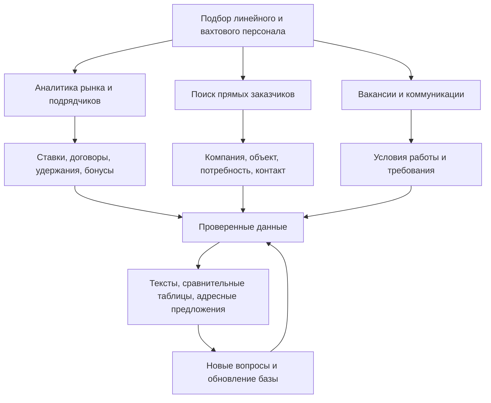

# Карта знаний

## Основные связи
Рабочая задача → необходимые данные → проверка источников → результат → обновление знаний.

## Узлы и переходы
| Направление | Какие знания нужны | Результат | Связанный раздел |
|---|---|---|---|
| Вакансии | Задачи, оплата, график, оформление, быт | Объявления и сообщения | [Коммуникации](knowledge/vacancies.md) |
| Аналитика | Сопоставимые условия и доказательства | Таблица сравнения | [Рынок](knowledge/market_research.md) |
| Заказчики | Юрлицо, объекты, признаки потребности | Приоритетная база компаний | [Заказчики](knowledge/client_research.md) |
| Проверка | Источник, дата, уверенность | Прослеживаемые выводы | [Источники](SOURCES.md) |

## Как направления связаны
- Аналитика рынка даёт материал для обсуждения условий, но не разрешает переносить условия конкурентов в собственную вакансию.
- Подтверждённые условия вакансии становятся основой текста и ответов кандидатам.
- Исследование заказчиков формирует гипотезы о потребности в персонале; гипотезы проверяются до включения в коммерческое предложение.
- Вопросы кандидатов показывают пробелы в описании условий и помогают обновлять шаблоны.
